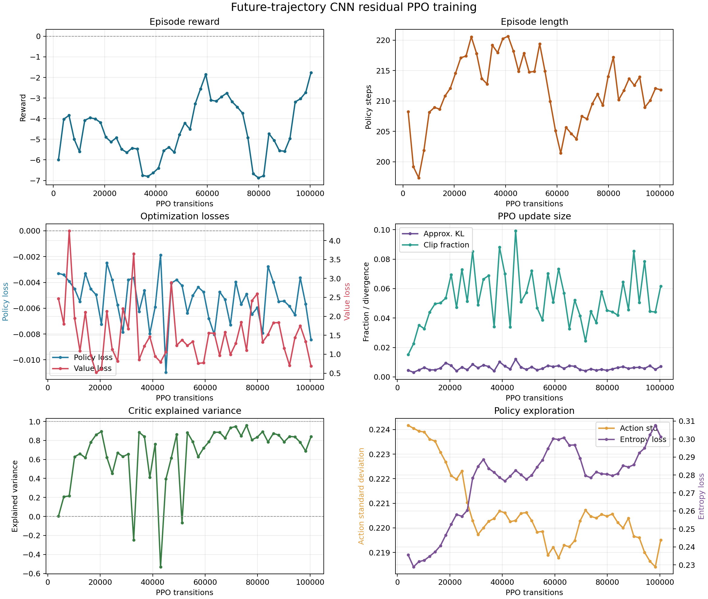
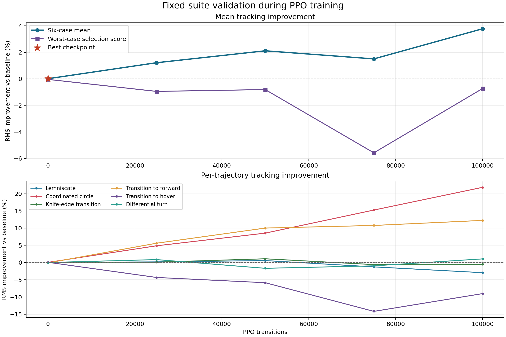

# Future-trajectory CNN consistent residual controller

This directory contains the retained evaluation artifacts for the selected
future-trajectory residual policy. The policy encodes `11 x 12` future-reference
features with two `Conv1d` layers, fuses them with a 16-dimensional current-state
branch, and outputs a bounded body-frame acceleration residual at 50 Hz.

The analytical flatness and INDI controller still runs at 500 Hz. A 10 Hz filtered
copy of the learned residual is applied consistently to the acceleration command,
reference acceleration, and reference jerk used by attitude/rate feedforward.
`transition-to-hover`, `differential-turn`, and circular knife-edge use zero
residual because this action channel did not improve those modes safely.

Detailed implementation and test results are in
[third_priority_test_report.md](third_priority_test_report.md).

## Retained results

| Trajectory | Baseline RMS | Policy RMS | Improvement |
| --- | ---: | ---: | ---: |
| Lemniscate | 0.182 m | 0.181 m | +0.57% |
| Coordinated circle | 0.125 m | 0.114 m | +8.54% |
| Knife-edge transition | 0.520 m | 0.514 m | +1.10% |
| Transition to forward | 0.151 m | 0.136 m | +10.01% |
| Transition to hover | 0.142 m | 0.142 m | 0.00% (gated) |
| Differential turn | 0.755 m | 0.755 m | 0.00% (gated) |
| Circular knife edge | 2.941 m | 2.941 m | 0.00% (safety-gated) |

The mean improvement over the six deployment cases is `+3.37%`; the worst
improvement is `0.00%`. No retained evaluation case has rotor or flap saturation.
The exact per-case NPZ logs and summary are under `evaluation_consistent_gated/`.

## Training and validation curves





The source CSV files are retained in
`training_logs/preview_residual_consistent/{progress,validation}.csv`.

## Reproduction

```bash
python evaluate_preview_policy.py \
  saved_models/preview_residual_consistent_gated.zip \
  --output-dir results/PreviewResidual/evaluation_consistent_gated

python plot_training_metrics.py training_logs/preview_residual_consistent \
  --output results/PreviewResidual/training_metrics_consistent.png

python plot_validation_metrics.py \
  training_logs/preview_residual_consistent \
  --output results/PreviewResidual/validation_metrics_consistent.png
```
